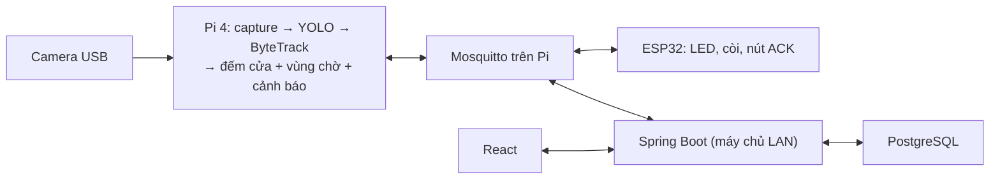

# 2. Thiết kế

Tài liệu trả lời: hệ thống hoạt động thế nào. Yêu cầu xem [1-requirements.md](1-requirements.md); lý do các lựa chọn xem [decisions/](decisions/).

## 2.1 Kiến trúc



| Thành phần | Nhiệm vụ | Khi máy chủ LAN tắt |
| --- | --- | --- |
| Pi + camera | Suy luận, đếm, quyết định cảnh báo, chạy broker | Chạy tiếp; broker giữ sự kiện cho backend |
| ESP32 | Hiện trạng thái, còi, gửi ACK | Chạy tiếp qua broker trên Pi |
| Spring + PostgreSQL + React | Lưu lịch sử, API, đăng nhập, báo cáo | Không truy cập được; nhận bù khi bật lại |

Pi là nơi duy nhất ra quyết định cảnh báo. Broker đặt trên Pi để vòng Camera → Pi → ESP32 không phụ thuộc máy chủ. React chỉ gọi Spring, không kết nối MQTT hay DB.

## 2.2 Tổ chức mã nguồn

| Thư mục | Trách nhiệm |
| --- | --- |
| `edge/retailvision/pipeline/` | Capture (camera hoặc file video), detector, tracker, vòng xử lý |
| `edge/retailvision/analytics/` | Hình học, đếm vạch, vùng chờ, máy trạng thái cảnh báo — không import OpenCV/YOLO |
| `edge/retailvision/messaging/` | MQTT client, topic, payload theo contract |
| `edge/retailvision/resilience/` | Độ mới dữ liệu, `clock_synced`, telemetry phút |
| `edge/retailvision/tools/` | `calibrate.py` (vẽ vạch/vùng), `fake_publisher.py` |
| `firmware/retail_alert/` | PlatformIO, Arduino-ESP32: Wi-Fi, MQTT, trạng thái, nút, LED, còi |
| `backend/` | Spring Boot: `mqtt/` (adapter), `service/` (nghiệp vụ, transaction), `controller/` (REST), `security/`, Flyway |
| `frontend/` | React + Vite, chia theo `features/` |
| `contracts/` | JSON Schema MQTT, ví dụ payload — nguồn sự thật cho mọi bên |
| `configs/` | Cấu hình mẫu, không chứa bí mật |
| `deploy/` | Mosquitto, chrony, systemd cho Pi; Compose cho máy chủ |
| `evaluation/` | Kịch bản test, nhãn, benchmark, kết quả |

Mã tham khảo: khung phân lớp backend theo [SmartHomeIoT](https://github.com/trungKoiKa/SmartHomeIoT/tree/master/backend) (bỏ JSP, MySQL, form-login); đọc camera/đo FPS theo [yolo_watchdog](../references/yolo_watchdog/README.md), ghi phần tái sử dụng vào `reuse-map.md`.

## 2.3 Phần cứng

| Thiết bị | Ghi chú |
| --- | --- |
| Raspberry Pi 4 Model B 4 GB | Nguồn 5,1 V/3 A, tản nhiệt + quạt, microSD 32–64 GB, Ethernet |
| Webcam USB UVC | 1280×720 nếu hỗ trợ; cố định chắc |
| ESP32 DevKitC (WROOM-32) | Wi-Fi 2,4 GHz |
| LED đỏ/xanh/vàng + 3 điện trở 330 Ω | Trạng thái |
| Còi chủ động + transistor NPN | Kêu khi OVERLOAD chưa ACK |
| Nút nhấn thường hở | ACK |
| OLED SSD1306 I2C (P1) | Hiện trạng thái, số người, thời lượng |
| Router/AP 2,4 GHz | LAN riêng, DHCP reservation cho Pi |
| Laptop/PC | Máy chủ LAN: Spring, PostgreSQL, React, NTP |

Bảng chân GPIO ghi vào `firmware/retail_alert/README.md` khi đấu xong.

## 2.4 Bố trí camera

- Camera cao hơn đầu người, nhìn chéo xuống; thấy người trước và sau vạch, thấy chân người trong vùng chờ.
- Vạch đặt ở đoạn cửa ít người đứng; vùng chờ tách khỏi vạch để hàng không tràn lên vạch; loại vị trí thu ngân khỏi đa giác.
- Tọa độ vạch/vùng lưu dạng chuẩn hóa 0–1, tạo bằng `tools/calibrate.py`. Dịch camera, đổi độ phân giải hoặc crop thì hiệu chuẩn lại.
- Góc đạt khi cả hai chức năng cùng đúng trên clip có hoạt động đồng thời.
- Ghi biên bản lắp vào `docs/operations/camera-calibration.md`: ngày, ảnh, chiều cao/góc đo thật, độ phân giải, tọa độ vạch/vùng, chiều vào, model size, `config_version`.

## 2.5 Xử lý trên Pi

### Một frame

```text
đọc frame mới nhất + timestamp → YOLO (class person) → ByteTrack
→ điểm giữa cạnh dưới bbox (tọa độ frame gốc)
→ đếm vạch | vùng chờ → máy trạng thái cảnh báo → MQTT
```

Model, tracker, camera khởi tạo một lần. Capture chỉ giữ frame mới nhất, không xếp hàng. Timer dùng `time.monotonic()`; khi replay video dùng timestamp của video.

### Cấu hình mẫu

```yaml
site_id: site01
profile: pilot
camera: { source: 0, requested_width: 1280, requested_height: 720 }
model:
  weights: ../../models/source/yolov8n.pt   # tương đối theo file YAML
  image_size: 320
  confidence: 0.35
  tracker: ../edge/bytetrack-lowfps.yaml
counting:
  line: [[0.45, 0.15], [0.45, 0.85]]
  deadband_px: 12
  min_stable_observations: 2
  direction_a_to_b: in
queue:
  polygon: [[0.60, 0.25], [0.95, 0.25], [0.95, 0.90], [0.60, 0.90]]
  dwell_seconds: 2.0
alert: { on_count: 5, on_hold_seconds: 60, off_count: 3, off_hold_seconds: 10 }
health: { camera_stale_seconds: 3, analysis_stale_seconds: 3 }
mqtt:
  host: 127.0.0.1
  root: retailvision/v1/site01
  device_id: edge01
  node_id: node01
  state_interval_seconds: 1
  telemetry_interval_seconds: 60
```

Mật khẩu MQTT lấy từ biến môi trường. Validation từ chối `off_count >= on_count` và thời gian âm.

### Đếm qua vạch

- Mỗi track lưu phía ổn định cuối cùng. Một lượt được ghi khi track chuyển từ phía này sang phía kia, đứng yên ở phía mới ≥ `min_stable_observations` lần quan sát, và quỹ đạo cắt **đoạn** vạch (không phải đường thẳng kéo dài).
- Dải `deadband_px` hai bên vạch không tính là phía nào để chống rung.
- Vào rồi quay ra là hai lượt. Track mới xuất hiện giữa vạch chưa được tính. Mất track không bù lượt.

### Vùng chờ và cảnh báo

Người được tính khi điểm chân ở trong đa giác liên tục ≥ `dwell_seconds`, và chỉ với track còn quan sát mới.

| Từ | Điều kiện | Sang |
| --- | --- | --- |
| NORMAL | `queue_count ≥ on_count` liên tục `on_hold` giây | OVERLOAD, tạo `alert_id`, phát OPEN |
| OVERLOAD | `queue_count ≤ off_count` liên tục `off_hold` giây | NORMAL, phát END `NORMALIZED` |
| Bất kỳ | Không có frame/kết quả mới trong 3 giây | UNKNOWN, `queue_count=null`; alert đang mở END `INTERRUPTED` |
| UNKNOWN | Có dữ liệu mới | NORMAL, timer tính lại từ đầu |
| OVERLOAD | Đổi settings | END `CONFIG_CHANGED`, reset timer |

Điều kiện bị ngắt thì reset timer tương ứng. ACK hợp lệ (đúng `alert_id` đang mở, lần đầu) đặt `acked=true` và phát transition ACK; không đổi trạng thái.

| Tham số | Pilot | Demo |
| --- | --- | --- |
| dwell | 2 giây | 2 giây |
| on_count / on_hold | 5 người / 60 giây | 2 người / 10 giây |
| off_count / off_hold | 3 người / 10 giây | 1 người / 5 giây |

Dashboard và kết quả đo luôn ghi profile đang dùng.

### Tracking ở FPS thấp

Ở khoảng 3 FPS người dịch chuyển nhiều giữa hai frame nên ByteTrack (ghép theo IoU) dễ đổi ID. Tham số `track_buffer` tính theo frame, Ultralytics mặc định coi luồng 30 FPS. Dùng file tracker riêng, chỉnh theo FPS đo được trên Pi; chọn góc camera để chuyển động nhỏ so với kích thước bbox.

### Model

YOLOv8n pretrained, class person. So sánh `.pt` 320, NCNN 320, NCNN 416 trên cùng clip và cùng Pi; chọn theo cả độ đúng và FPS. Export lưu tại `models/exported/<model>-<backend>-<imgsz>/`. Chỉ fine-tune khi có bằng chứng detector là nguyên nhân lỗi.

## 2.6 MQTT

Bảng topic, payload và ACL đầy đủ: [contracts/mqtt/README.md](../contracts/mqtt/README.md). Tóm tắt:

- Pi phát `state` 1 Hz (QoS 0), sự kiện crossing/alert/telemetry (QoS 1), `status` retained kèm Last Will.
- ESP32 chỉ nghe `state`; bản tin 1 Hz vừa là trạng thái vừa là heartbeat.
- ESP32 gửi `operator-ack` tới Pi; Spring không nghe topic này mà lấy ACK từ transition của Pi.

**Bù dữ liệu khi máy chủ tắt:** Mosquitto bật persistence; Spring kết nối `cleanSession=false` với client-id cố định, nên broker giữ sự kiện QoS 1 khi Spring offline. Spring ack thủ công: commit DB xong mới ack, lỗi thì broker gửi lại; bản tin trùng bị chặn bằng khóa unique `event_id`. Hàng đợi có giới hạn; vượt giới hạn thì báo gap.

## 2.7 Firmware ESP32

| Điều kiện | Đỏ | Xanh | Vàng | Còi |
| --- | --- | --- | --- | --- |
| Chưa có state / quá 5 giây / UNKNOWN | Tắt | Tắt | Nháy | Tắt |
| NORMAL | Tắt | Sáng | Tắt | Tắt |
| OVERLOAD, `acked=false` | Nháy | Tắt | Tắt | Kêu |
| OVERLOAD, `acked=true` | Sáng | Tắt | Tắt | Tắt |

- Timeout đo bằng `millis()` từ state hợp lệ cuối; payload sai không được coi là NORMAL.
- Nút: debounce, phát một lần mỗi cạnh nhấn, chỉ có tác dụng khi OVERLOAD chưa ACK.
- PubSubClient chỉ publish QoS 0, nên ACK gửi lại **cùng `ack_id`** mỗi 1 giây tới khi state báo `acked=true`, `alert_id` đổi hoặc quá 10 lần.
- Reconnect Wi-Fi/MQTT theo lịch `millis()` (ví dụ 3 giây), không chặn LED/nút. Last Will `OFFLINE` trên `node01/status`.
- Wi-Fi/MQTT password trong `secrets.h`, không commit.

## 2.8 Backend

Java 21, Spring Boot 3.5, Spring Web, Data JPA, Security, Flyway, Eclipse Paho, PostgreSQL 17.

**Luồng nhận MQTT:** `mqtt/` nhận bản tin → validate schema → `service/ingestion/` ghi trong transaction (bỏ qua nếu `event_id` đã có) → commit → `messageArrivedComplete`.

**Bảng** (mỗi giai đoạn thêm migration của mình, `ddl-auto=validate`):

| Migration | Bảng | Khóa chính yếu |
| --- | --- | --- |
| V001 | `edge_session`, `crossing_event` | `event_id` unique, index `occurred_at` |
| V002 | `alert_event` (một dòng mỗi alert: opened/acked/ended, `end_reason`), `alert_transition` | `alert_id` unique; `event_id` unique |
| V003 | `telemetry_minute` (`valid_seconds`, `queue_avg`, `queue_max`), `device_status` | `session_id` + `seq` unique |
| V004 | `app_user` | `username` unique, BCrypt |
| V005 (P1) | `settings_revision` | `request_id` unique |

Mọi bảng sự kiện có `occurred_at` (giờ Pi, UTC) và `server_received_at`. Báo cáo nhóm theo `Asia/Ho_Chi_Minh`. Coverage lấy từ `valid_seconds`; phút không có telemetry là gap, không phải 0.

**Báo cáo theo giờ:** lượt vào/ra; phút quan sát hợp lệ; số người vùng chờ trung bình/lớn nhất (chỉ phút hợp lệ); số alert và số phút OVERLOAD trong giờ; độ trễ ACK = `acked_at − opened_at` (tách alert chưa ACK).

**REST:**

| Endpoint | Quyền |
| --- | --- |
| `POST /api/auth/login`, `POST /api/auth/logout`, `GET /api/auth/me` | Công khai / đã đăng nhập |
| `GET /api/overview`, `/api/footfall?from=&to=`, `/api/alerts`, `/api/devices`, `/api/health` | MANAGER, ADMIN |
| `GET /api/reports/export.csv` | MANAGER, ADMIN |
| `GET/PUT /api/settings` (P1) | MANAGER, ADMIN |
| Quản lý tài khoản | ADMIN |

**Đăng nhập:** Spring Security session cookie (`HttpOnly`, `SameSite=Lax`), CSRF cho request ghi, quyền kiểm ở API. Lát cắt đầu chạy không đăng nhập trong LAN tin cậy.

**Đổi ngưỡng (P1):** `PUT /api/settings` lưu PENDING, publish `settings/set` kèm `request_id` và `expected_settings_revision`; Pi kiểm, áp dụng nguyên bộ, trả `settings/result`. Hết thời gian chờ thì hiện "chưa xác nhận", không coi là đã áp dụng. Chỉ dwell/count/hold sửa được từ web; vạch/vùng/model sửa bằng file.

## 2.9 Frontend

React 19 + TypeScript + Vite 7. Trang: Login, Overview, Footfall, Alerts, Devices (Settings P1 gộp với Devices). Polling 2–5 giây. Luôn hiện tuổi dữ liệu và profile; UNKNOWN/stale hiển thị rõ, không hiện 0. Dev proxy `/api` để cùng origin.

## 2.10 Xử lý lỗi

| Sự cố | Hành vi |
| --- | --- |
| Mất Internet, LAN còn | Mọi thành phần chạy bình thường |
| Máy chủ LAN tắt | Pi/ESP32 chạy; broker giữ sự kiện; bù khi bật lại |
| PostgreSQL lỗi | Spring không ack; broker gửi lại |
| Hàng đợi broker đầy | Log broker; báo cáo hiện gap |
| Broker/Pi tắt, Wi-Fi node mất | ESP32 vàng sau 5 giây |
| Rút camera / frame cũ | UNKNOWN, `queue_count=null`, alert END `INTERRUPTED` |
| Pi khởi động lại | Session mới; tracker và timer khởi tạo lại |
| Pi chưa đồng bộ giờ | `clock_synced=false`; báo cáo đánh dấu, đối chiếu `server_received_at` |
| ACK lặp hoặc sai alert | Pi bỏ qua |

## 2.11 Triển khai

| Thành phần | Phiên bản | Ghi chú |
| --- | --- | --- |
| Pi OS | Lite 64-bit (Trixie; fallback Bookworm nếu dependency lỗi) | Ghi image và kernel thực tế |
| Python edge | 3.13 (theo OS) | `edge/.venv`; lock riêng cho Pi |
| Ultralytics / OpenCV / paho-mqtt | 8.3.x / 4.x / 2.1.x | Khóa sau smoke test |
| Mosquitto | Bản apt của Pi OS | `persistence true`, giới hạn hàng đợi, ACL |
| chrony | Bản apt | Trỏ về NTP máy chủ LAN |
| ESP32 | Arduino-ESP32 3.x, PubSubClient 2.8, ArduinoJson 7 | Khóa trong `platformio.ini` |
| Backend | JDK 21, Spring Boot 3.5.x, Maven Wrapper | |
| DB | PostgreSQL 17 | Backup/restore phải thử thật |
| Frontend | Node 24 LTS, React 19, Vite 7 | Commit `package-lock.json` |

- **Pi:** chỉ chạy edge (systemd, không root, `--headless`), Mosquitto, chrony. Không chạy dashboard trên Pi.
- **Máy chủ LAN:** PostgreSQL, Spring, React build; `deploy/server/compose.yaml` khi từng phần chạy độc lập được.
- Lệnh cài đặt chỉ ghi vào README thành phần sau khi đã chạy thành công.

## 2.12 Quy ước

- JSON `snake_case`; Java/TypeScript theo quy ước ngôn ngữ, ánh xạ tại DTO.
- ID là UUID dạng chuỗi; thời gian ISO 8601 UTC; giờ Việt Nam chỉ khi hiển thị/tổng hợp.
- `settings` = ngưỡng sửa từ web, có revision; `config_version` = phiên bản profile kỹ thuật đầy đủ của edge.
- Đường dẫn trong YAML tính tương đối theo file YAML.
- Không commit: `.env`, `secrets.h`, model, video, dữ liệu runtime.
